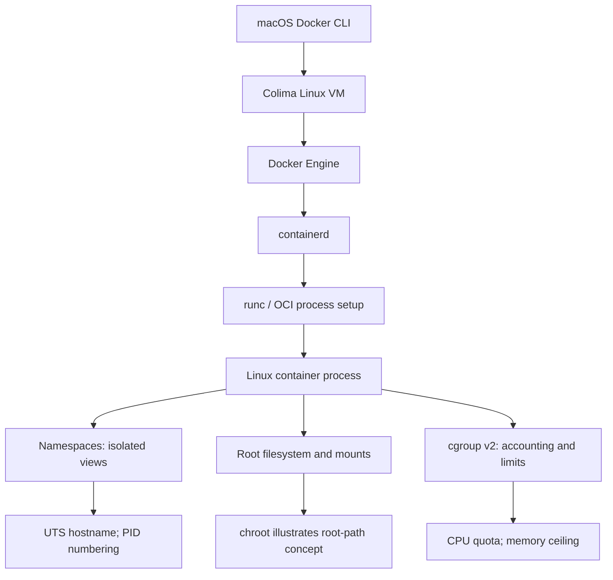

# SWE 320 CLO1 — Lab 2: Linux Isolation Primitives

**Course:** SWE 320 — Infrastructure as Code & Container Management  
**Module:** CLO1 — Container Runtime Architecture and OCI Mechanics  
**Lab:** 2 — Linux isolation primitives (UTS, PID, chroot and cgroups)  
**Environment:** Intel macOS host, Docker CLI with Colima Linux VM (Ubuntu)  
**Evidence:** Commands and terminal outputs supplied during the practical session

## Objective

Demonstrate how Linux provides the primitives used by container runtimes: namespace-scoped views of system resources, an altered filesystem root, and kernel-enforced resource accounting and limits.

> **Scope of verification:** This report documents four hands-on exercises actually completed. It does not claim that memory OOM events, CPU throttling counters, mount namespace isolation, or a full OCI runtime trace were tested.

## 1. Tool availability

Within the Colima VM, the following commands were confirmed installed:

```text
/usr/bin/unshare
/usr/sbin/chroot
/usr/bin/lsns
/usr/bin/nsenter
```

`unshare` creates namespaces; `lsns` lists namespaces; `nsenter` joins namespaces of an existing process; `chroot` changes a process's filesystem root (and **does not** create a namespace).

## 2. Experiment A — UTS namespace / hostname isolation

### Commands

```bash
colima ssh
hostname
sudo unshare --uts /bin/bash
hostname lab2-isolated
hostname
exit
hostname
```

### Observed results

```text
colima
lab2-isolated
colima
```

**Finding:** The shell launched by `unshare --uts` had a separate UTS namespace and could change its hostname without changing the hostname visible to the original Colima shell. Both shells continued using the same Linux kernel.

## 3. Experiment B — PID namespace / process visibility

### Commands

```bash
sudo unshare --pid --fork --mount-proc /bin/bash
echo $$
ps -ef
echo "Inside namespace PID: $$"
readlink /proc/self/ns/pid
exit
echo "Parent shell PID: $$"
readlink /proc/self/ns/pid
```

### Observed process list

```text
1

UID          PID    PPID  C STIME TTY          TIME CMD
root           1       0  0 23:19 pts/1    00:00:00 /bin/bash
root           8       1  0 23:20 pts/1    00:00:00 ps -ef
```

### Namespace comparison

| Property | Isolated shell | Original Colima shell |
| --- | --- | --- |
| Shell PID as viewed locally | 1 | 2103139 |
| PID namespace inode | 4026532553 | 4026531836 |

**Finding:** The namespace inode values differ, confirming that the child shell ran in a distinct PID namespace. Bash appeared as PID 1 in the child namespace; `ps` was PID 8 when observed. `--mount-proc` arranged a process listing appropriate to the new PID namespace.

**Interpretation caution:** PID 1 and PID 2103139 in the table are *different shell processes*, not two observed PIDs of the same process. A process in the child PID namespace can have another PID when inspected from the parent namespace, but that particular mapping was not measured here.

## 4. Experiment C — Minimal filesystem root with chroot

### First attempt

```bash
sudo mkdir -p /tmp/lab2-root
sudo cp /bin/bash /tmp/lab2-root/
sudo chroot /tmp/lab2-root /bash
```

Observed:

```text
chroot: failed to run command ‘/bash’: No such file or directory
```

**Reason:** `/bash` was copied, but its ELF dynamic loader and shared libraries were not yet present inside the new root. The error did not mean that the `/bash` file itself was absent.

### Dependency inspection

```bash
ldd /bin/bash
```

Observed dependencies:

```text
linux-vdso.so.1 (kernel-provided)
libtinfo.so.6 => /lib/x86_64-linux-gnu/libtinfo.so.6
libc.so.6 => /lib/x86_64-linux-gnu/libc.so.6
/lib64/ld-linux-x86-64.so.2
```

The virtual dynamic shared object (`linux-vdso.so.1`) is kernel-provided and was not copied.

### Successful setup

```bash
sudo mkdir -p /tmp/lab2-root/lib/x86_64-linux-gnu
sudo mkdir -p /tmp/lab2-root/lib64

sudo cp -L /lib/x86_64-linux-gnu/libtinfo.so.6 /tmp/lab2-root/lib/x86_64-linux-gnu/
sudo cp -L /lib/x86_64-linux-gnu/libc.so.6 /tmp/lab2-root/lib/x86_64-linux-gnu/
sudo cp -L /lib64/ld-linux-x86-64.so.2 /tmp/lab2-root/lib64/

sudo chroot /tmp/lab2-root /bash
pwd
echo /*
exit
```

Observed:

```text
bash-5.2# pwd
/
bash-5.2# echo /*
/bash /lib /lib64
bash-5.2# exit
exit
```

**Finding:** The Bash process could run with `/tmp/lab2-root` treated as its `/`. This was a change in filesystem root, not a separate kernel, mount namespace, or secure container boundary. A privileged process may be able to escape `chroot`; it must not be treated as a security sandbox by itself.

### Resulting minimal root layout

```text
/tmp/lab2-root/
├── bash
├── lib/
│   └── x86_64-linux-gnu/
│       ├── libc.so.6
│       └── libtinfo.so.6
└── lib64/
    └── ld-linux-x86-64.so.2
```

## 5. Experiment D — cgroup v2 inspection and limits

### Inspect Colima VM cgroup configuration

```bash
stat -fc %T /sys/fs/cgroup
cat /proc/self/cgroup
cat /sys/fs/cgroup/cgroup.controllers
```

Observed:

```text
cgroup2fs
0::/user.slice/user-502.slice/session-6.scope
cpuset cpu io memory hugetlb pids rdma misc
```

**Finding:** The Colima VM uses the unified cgroup v2 hierarchy. The inspected shell belonged to a systemd session cgroup. The listed controllers are available at the inspected hierarchy level; the output alone does not show which are enabled for a particular descendant cgroup.

### Create a limited container from macOS

```bash
docker run -d \
  --name lab2-memory \
  --memory=256m \
  --cpus=0.5 \
  alpine:latest \
  sleep 600
```

Created container ID:

```text
05f68a68bafe0ea0df67636fb844b07c309118cd6ed941e508f861e8ae5a432a
```

Inspect Docker's resource configuration:

```bash
docker inspect lab2-memory \
  --format 'Memory={{.HostConfig.Memory}} bytes, NanoCPUs={{.HostConfig.NanoCpus}}'
```

Observed:

```text
Memory=268435456 bytes, NanoCPUs=500000000
```

Inspect the kernel-exposed cgroup values inside the container:

```bash
docker exec lab2-memory cat /sys/fs/cgroup/memory.max
docker exec lab2-memory cat /sys/fs/cgroup/cpu.max
```

Observed:

```text
268435456
50000 100000
```

### Interpretation

| Limit | Docker setting | cgroup v2 evidence | Meaning |
| --- | --- | --- | --- |
| Memory | `--memory=256m` | `memory.max = 268435456` | 256 MiB memory ceiling |
| CPU | `--cpus=0.5` | `cpu.max = 50000 100000` | 50,000 μs aggregate CPU quota per 100,000 μs period |

**Finding:** Docker's resource configuration corresponds to kernel-visible cgroup limits. The kernel enforces them; Docker Engine coordinates container creation and configuration, while containerd and runc participate in runtime setup.

**CPU vs memory:** Exceeding a CPU quota generally results in **throttling** until the next quota period, not termination. If a container cannot satisfy its memory usage within the memory cgroup limit, the kernel may trigger a **cgroup OOM event** and kill one or more processes. These outcomes were discussed but **not directly induced or measured** during this experiment.

### Cleanup

The recommended cleanup command is:

```bash
docker rm -f lab2-memory
```

**Cleanup status:** The user was instructed to run this command, but no confirming terminal output was provided. Do not assume the container was removed.

## 6. How these primitives relate to Docker



This diagram is conceptual, not a trace of runtime system calls. Production container root filesystem setup involves mount namespaces and mount operations as well as filesystem layering; `chroot` alone is insufficient.

## 7. Questions and answers

**Q1. What is a Linux namespace?**  
A kernel mechanism that makes processes observe a scoped view of certain resources. UTS namespaces isolate hostname information; PID namespaces isolate PID numbering and process visibility.

**Q2. Why did the new Bash shell report PID 1?**  
It was the first process in the newly created PID namespace. The parent namespace still maintains its own PID mapping.

**Q3. Why did the first `chroot` fail although `/bash` existed?**  
The required dynamic loader and shared libraries were missing inside the new root. Copying those dependencies allowed Bash to start.

**Q4. Does `chroot` provide complete container security?**  
No. It changes a process's apparent filesystem root but does not isolate processes, networking, or resources, and is not a robust security boundary by itself.

**Q5. What does `0::/user.slice/user-502.slice/session-6.scope` show?**  
The process's membership path in the unified cgroup v2 hierarchy.

**Q6. Who enforces CPU and memory limits?**  
The Linux kernel's cgroup controllers. Docker specifies the configuration and the runtime stack arranges container execution.

**Q7. What happens when CPU usage reaches the configured quota?**  
The kernel normally throttles the group's CPU execution until quota is replenished; the task may take longer.

**Q8. What happens when a memory limit cannot be respected?**  
Memory reclamation may be attempted, and a cgroup OOM event may kill processes. An application-visible error or exit status depends on the exact circumstances.

## 8. Completion checklist

- [x] Verified required Linux commands exist
- [x] Created and tested UTS namespace
- [x] Created and tested PID namespace
- [x] Compared PID namespace identifiers
- [x] Diagnosed missing ELF loader/libraries in chroot
- [x] Built and entered minimal chroot filesystem
- [x] Identified cgroup v2 and available controllers
- [x] Applied Docker CPU and memory limits
- [x] Read matching cgroup v2 limit values
- [x] Explained namespace, chroot, cgroup, throttling and OOM behavior
- [ ] Confirm temporary container cleanup
- [ ] Attach raw terminal transcript/screenshots if required for grading

**Summary:** The observed experiments demonstrate Linux namespace isolation, a changed process filesystem root, and kernel-visible resource limits. Together these explain several important mechanisms used by container runtimes, without implying that they alone constitute a full production-grade container security boundary.
