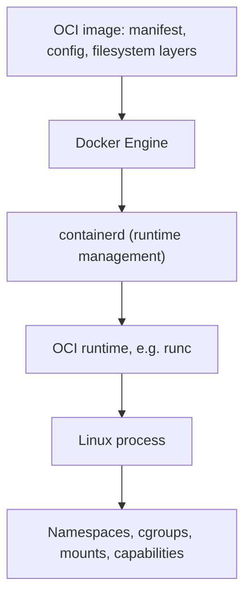

# SWE 320 CLO1 — Lab 3: OCI Specifications and Container Lifecycle

**Environment:** macOS Docker CLI connected to Colima Linux VM; Linux amd64 image.
**Objective:** Trace the image-to-process lifecycle and distinguish image configuration, container metadata, and executing Linux processes.
**Evidence:** Terminal outputs observed in the practical session, 21 November 2026.

## 1. Conceptual architecture



This is a conceptual relationship, not a claim that every Docker operation follows one universal call sequence. The OCI Image Specification describes image formats; the OCI Runtime Specification defines a runtime configuration and lifecycle contract. Docker Engine orchestrates user-facing operations; containerd manages container runtime operations; an OCI runtime such as runc sets up the isolated process. Linux kernel primitives implement isolation and resource controls.

## 2. Pull and inspect the image

```bash
docker pull nginx:alpine
docker image inspect nginx:alpine \
  --format 'Image ID: {{.Id}}
Architecture: {{.Architecture}}
OS: {{.Os}}
Entrypoint: {{json .Config.Entrypoint}}
Command: {{json .Config.Cmd}}'
docker image inspect nginx:alpine --format '{{json .RootFS.Layers}}'
```

Observed:

```text
Digest: sha256:fb4658584bd9a916ffb6f6e365f97c25cfdb2923801f551ea08356e695f14ff7
Status: Downloaded newer image for nginx:alpine
Image ID: sha256:fb4658584bd9a916ffb6f6e365f97c25cfdb2923801f551ea08356e695f14ff7
Architecture: amd64
OS: linux
Entrypoint: ["/docker-entrypoint.sh"]
Command: ["nginx","-g","daemon off;"]
```

The inspected `RootFS.Layers` array contained **eight** layer digests:

```text
sha256:75f1d9657d880da5f75298e8f40e9928bb6e260c50d26f97af196845307e3064
sha256:2e9bfabaf10d4c116a92511343f6be7f27a973e299e0b2ad6f825179a448aa50
sha256:3bca624210963cb604a86768d7ea70dcc2391463a88d250b7514f2353a6c63b0
sha256:fe95f42d27827e8e08ae9fd84052d16b69c94c8fd71f3809637887fd08e70c94
sha256:73884487472cb5d5453348edd7f004ddde6570cc26ba05a562d65befb511cbeb
sha256:38420c71c9bb7230a642d914396b11a44f3d9a175ad68be6d84dbca71b0e5e91
sha256:ed926ec8b48d612ca7c0ebcd7a2b556fcaf253cfec5052ded3340b368206928a
sha256:8e9b46bfa70aa722e34fd952e3ae6220309090149b55c3d490d76cad0b672ea1
```

**Interpretation:** The entrypoint script performs initialization; the configured command runs Nginx in the foreground. The image is reusable and its read-only layers can back multiple container instances. An image ID and registry manifest digest are conceptually different identifiers, even if a particular output displays matching values.

## 3. Create without starting

```bash
docker create --name lab3-nginx nginx:alpine
docker inspect lab3-nginx \
  --format 'ID={{.Id}}
State={{.State.Status}}
PID={{.State.Pid}}
Image={{.Image}}'
docker ps -a --filter name=lab3-nginx
```

Observed:

```text
ID=93ee90f0ae128bb457db6c28e51af0d4ce97e65587cfaea8a90b7d699931205d
State=created
PID=0
Image=sha256:fb4658584bd9a916ffb6f6e365f97c25cfdb2923801f551ea08356e695f14ff7
```

**Interpretation:** The container record and configuration exist but its main application process has not started. PID 0 here means no active main container process.

## 4. Start and inspect execution

```bash
docker start lab3-nginx
docker inspect lab3-nginx \
  --format 'State={{.State.Status}}
PID={{.State.Pid}}
Running={{.State.Running}}
StartedAt={{.State.StartedAt}}'
docker top lab3-nginx
docker logs --tail 15 lab3-nginx
```

Observed:

```text
State=running
PID=2185634
Running=true
StartedAt=2026-11-21T15:22:34.483965982Z
```

`docker top` showed:

| Process | Colima VM PID | Colima VM PPID |
| --- | ---: | ---: |
| nginx master | 2185634 | 2185611 |
| nginx worker | 2185694 | 2185634 |
| nginx worker | 2185695 | 2185634 |

The logs reported Nginx version **1.31.9**, Linux kernel **6.8.0-117-generic**, successful initialization, and two worker processes. These results show that the container was running its application, not merely present in Docker metadata.

## 5. Verify PID namespace isolation

```bash
docker exec lab3-nginx sh -c 'ps -o pid,ppid,args'
docker exec lab3-nginx readlink /proc/1/ns/pid
colima ssh
readlink /proc/self/ns/pid
sudo readlink /proc/1/ns/pid
```

Observed from inside the container:

```text
PID  PPID  COMMAND
1       0  nginx: master process nginx -g daemon off;
30      1  nginx: worker process
31      1  nginx: worker process
32      0  ps -o pid,ppid,args
pid:[4026532555]
```

Observed in Colima:

```text
pid:[4026531836]
```

The unprivileged Colima command `readlink /proc/1/ns/pid` returned no output because reading the symlink was denied. `ls -l /proc/1/ns/pid` reported **Permission denied**; `sudo readlink` returned the namespace inode above.

**Interpretation:** The same Nginx master is PID **1** inside its container PID namespace and PID **2185634** when observed from the Colima VM's parent PID namespace. The namespace inode IDs differ, confirming isolation. The temporary `docker exec` process appeared as PID 32, PPID 0; its parent was outside the visible PID namespace.

## 6. Stop and inspect termination

```bash
docker stop lab3-nginx
docker inspect lab3-nginx \
  --format 'State={{.State.Status}}
PID={{.State.Pid}}
ExitCode={{.State.ExitCode}}
FinishedAt={{.State.FinishedAt}}'
docker ps -a --filter name=lab3-nginx
```

Observed:

```text
State=exited
PID=0
ExitCode=0
FinishedAt=2026-11-21T15:37:58.200104409Z
```

**Interpretation:** Nginx terminated successfully; the container record remained in the `exited` state. Exit code 0 indicates successful process termination in this observation.

## 7. Remove and verify image retention

```bash
docker rm lab3-nginx
docker ps -a --filter name=lab3-nginx
docker image ls nginx
```

Observed: `docker rm` returned `lab3-nginx`; the filtered container list was empty; `nginx:alpine` remained available with image ID prefix `fb4658584bd9`. A second `docker rm lab3-nginx` correctly reported **No such container** because it had already been removed. A separate `nginx:1.27-alpine` image was also present and marked in use; it was not part of the lifecycle test.

## 8. Lifecycle diagram


## 9. Conclusions and acceptance gate

- [x] Identified image OS, architecture, entrypoint and command
- [x] Counted and recorded eight image filesystem layer digests
- [x] Observed container state before and after start
- [x] Identified container ID and VM-side main process PID
- [x] Verified separate PID namespace identifiers and PID mapping
- [x] Examined Nginx logs and worker processes
- [x] Observed graceful termination and exit code
- [x] Removed container and verified image retention
- [x] Produced lifecycle diagram and conceptual Docker Engine/containerd/runc explanation

**Key takeaway:** An OCI-compatible image supplies reusable filesystem and configuration data. Docker manages the container lifecycle, and the runtime stack starts Linux processes with configured isolation. Stopping a container ends its running process but leaves the container record; removing the container deletes that instance without deleting the image.
